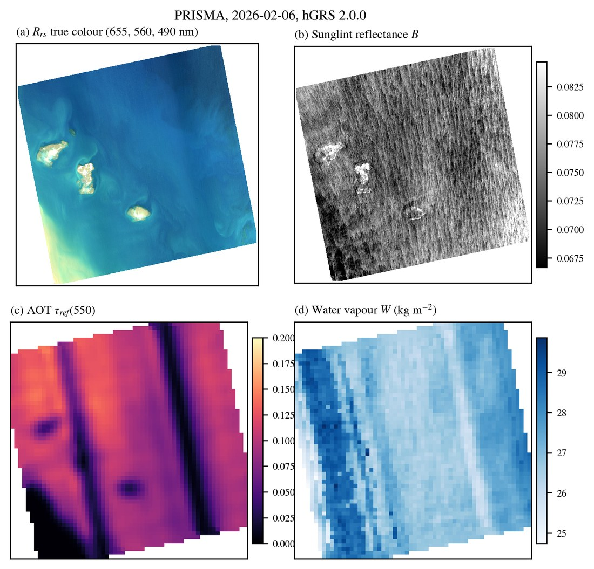
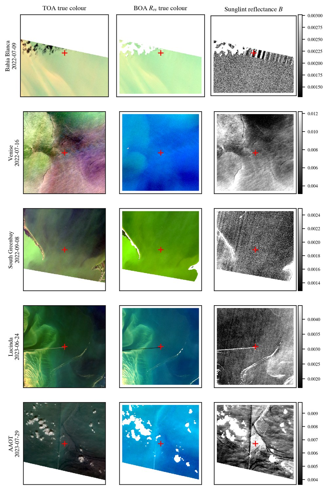
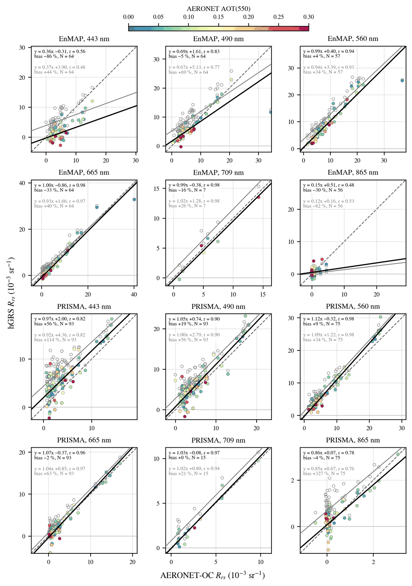
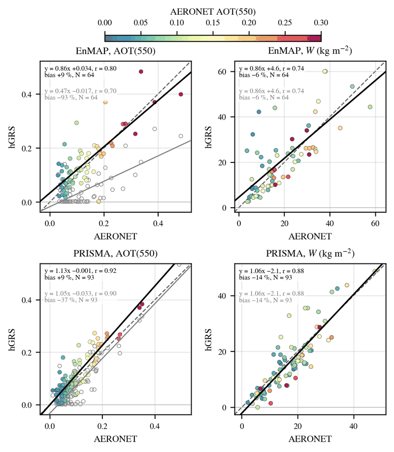
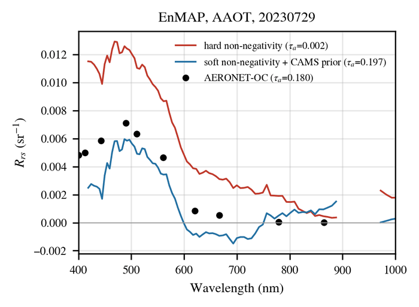
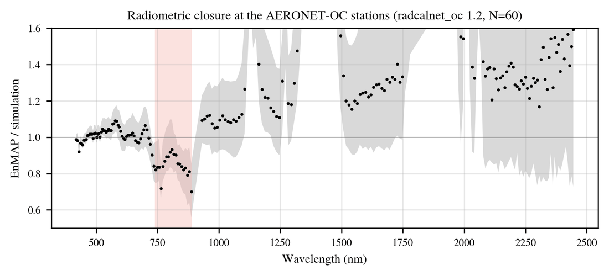

# hGRS package
## Hyperspectral Glint Removal System for hyperspectral remote sensing of the aquatic environment

# WARNING: this is a working version between collaborators please do not use it as is. Stable version will come soon.

hGRS is an atmospheric correction processor that retrieves the remote-sensing reflectance $R_{rs}$ of water
bodies (ocean, coastal and inland waters) from hyperspectral satellite images. From the top-of-atmosphere (TOA)
reflectance, it retrieves:

- the gaseous absorption, with the water vapour column fitted on the image and the absorption coupled with the
  scattering (photon path-length model),
- the aerosol optical thickness and the sunglint, from the near-infrared and short-wave infrared bands, with the
  constraint that the water reflectance stays non-negative in the visible and near infrared,

using look-up tables of the coupled atmosphere-ocean radiative transfer (OSOAA, OPAC aerosol models, rough sea
surface) and the CAMS atmospheric composition.

- Version: 2.1.0 ([CHANGELOG](CHANGELOG.md), [ROADMAP](ROADMAP.md))
- Documentation: https://hgrs.readthedocs.io (methods, configuration, tutorials, research notebooks)
- Licence: Apache 2.0

## Sensors

| Sensor | Level-1 input | Command | Status |
|---|---|---|---|
| EnMAP | L1C directory | `hgrs_enmap` | validated with AERONET-OC |
| PRISMA | L1 file (`.he5`) + L2C file (viewing angles) | `hgrs_prisma` | validated with AERONET-OC |
| EMIT | L1B_RAD NetCDF | `hgrs_emit` | driver available, not validated |
| Hyperion | L1R | `hgrs_hyperion` | driver available, not validated |
| Tanager | L1 | `hgrs_tanager` | driver available, not validated |

## Installation

Python >= 3.9. Clone [the repository](https://github.com/Tristanovsk/hgrs) and, in the local copy:

```commandline
pip install .
```

Optional dependencies:

```commandline
conda install -c conda-forge xesmf                                            # reprojection of PRISMA images
conda install -c conda-forge hvplot bokeh panel datashader jupyter jupyterlab  # visualization
```

Cloud masking uses [OmniCloudMask](https://github.com/DPIRD-DMA/OmniCloudMask), on the GPU when one is available.

### Look-up tables

The look-up table (LUT) files, shared with GRS, are published on [Zenodo](https://doi.org/10.5281/zenodo.23394202)
(about 850 MB). Download them into the default folder of hGRS, `~/.local/share/hgrs/lut` on Linux (no configuration
needed), or keep them in another folder and write it in your user configuration file (`~/.config/hgrs/config.yml`,
no reinstallation needed when it changes). Then check the LUTs:

```commandline
hgrs_config --init path/to/lut   # only if the LUTs are not in the default folder
hgrs_config --download           # checksums verified; --force to download them again
hgrs_config
```

All the settings are described in the [configuration page](https://hgrs.readthedocs.io/en/latest/configuration.html)
of the documentation.

### CAMS data

Each image needs a CAMS atmospheric composition file (NetCDF) covering its date and area, with the surface
pressure (`sp`), the columns of ozone (`gtco3`), nitrogen dioxide (`tcno2`) and methane (`tc_ch4`), and the
aerosol optical depth at 469, 550, 670, 865 and 1240 nm (CAMS global forecasts or reanalysis, from the
[Atmosphere Data Store](https://ads.atmosphere.copernicus.eu)).

## Usage

Command line (see `hgrs_enmap --help`, `hgrs_prisma --help`):

```commandline
hgrs_enmap ENMAP01-____L1C-DT0000001234_20240701T103000Z_001_V010400_20240702T000000Z \
    --cams_file cams_2024-07.nc --odir ./L2A

hgrs_prisma PRS_L1_STD_OFFL_20210906103712_20210906103717_0001.he5 \
    --l2_path PRS_L2C_STD_20210906103712_20210906103717_0001.he5 --cams_file cams_2021-09.nc --odir ./L2A
```

Python:

```python
import hgrs

process = hgrs.Process()
# EnMAP: path of the L1C directory; PRISMA: [L1 file, L2C file]
process.execute('ENMAP01-____L1C-DT0000001234_20240701T103000Z_001_V010400_20240702T000000Z',
                'cams_2024-07.nc')
process.l2_prod                       # xarray.Dataset of the L2A product
process.write_output('ENMAP01_L2A_hgrs.nc')
```

The L2A product (NetCDF) contains the remote-sensing reflectance `Rrs` (400-1150 nm), the sunglint reflectance at
full resolution `brdfg_full`, the aerosol optical thickness at 550 nm (`aot_ref`, `aot_ref_smoothed`) and the water
vapour column (`tcwv`) on the coarse grid of the retrievals, the cloud and water masks, and the CAMS parameters.
See the [usage page](https://hgrs.readthedocs.io/en/latest/usage.html).

### Image catalog

`hgrs_catalog` manages a local database of EnMAP and PRISMA images (storage layout, STAC catalogue, GeoParquet
index, views by site, ingest of new downloads): `hgrs_catalog build|ingest|search ...` (`hgrs_catalog --help`).

## Main settings

The defaults are those of version 2.1.0; the former behaviour (version 1.2.0) is available with
`previous_behavior: true` in the user configuration file or the environment variable `HGRS_PREVIOUS_BEHAVIOR=1`. Some options are experimental and off by default (see the
[CHANGELOG](CHANGELOG.md) and the [methods page](https://hgrs.readthedocs.io/en/latest/methods.html)):

- `gas_coupling: path_length` (default) or `decoupled`: transmittance of the path reflectance coupled with the
  scattering;
- `o2_model: lbl_o2b` (default; line-by-line O2 in the O2-B band, REPTRAN in the O2-A band), `lbl` or `reptran`;
- `aerosol: prior: cams`, `nonnegativity: soft` (experimental): soft non-negativity constraint and prior on the
  CAMS AOT, for dark waters where the hard constraint cannot be met;
- `water_vapor: prior: cams` (experimental): prior on the CAMS water vapour column;
- `product: enmap_detector_offset: vnir_ramp` (experimental): correction of the radiometric mismatch of the
  EnMAP VNIR and SWIR detectors over dark water;
- `product: solar_spectrum`: TSIS-1 (default), Thuillier (2003) and others.

## Validation

The validation scripts are in [`validation/`](validation):

- `validation/aeronet_oc`: matchups with the AERONET-OC network for EnMAP and PRISMA (`run_versions.py` processes
  the matchups with several versions in memory-capped workers, `compare.py` computes the statistics), and a
  radiometric closure with TOA simulations at the stations (`closure.py`);
- `validation/hypernets`: matchups with the HYPERNETS hyperspectral radiometers;
- `validation/noise`: instrument noise of PRISMA and EnMAP over water (study in progress).

Main results so far (AERONET-OC; detailed in the [roadmap](ROADMAP.md) and the research pages of the
documentation):

- with the default hard non-negativity constraint, the aerosol optical thickness is underestimated over dark water,
  especially for EnMAP, whose VNIR near-infrared bands read 15-20 % below a radiative transfer simulation at the
  stations; the soft constraint with the CAMS prior (and, for EnMAP, the detector correction) removes most of this
  bias and divides the error of $R_{rs}$ in the blue-green by two;
- the EnMAP 763.7 nm band reads about 9 % low over bright land, which the REPTRAN O2-A absorption compensates
  ([O2-A closure](docs/source/tutorials/research/o2a_enmap_closure.rst)).

## References

- Harmel, T., Chami, M., Tormos, T., Reynaud, N., Danis, P.-A. (2018). Sunglint correction of the Multi-Spectral
  Instrument (MSI)-SENTINEL-2 imagery over inland and sea waters from SWIR bands. *Remote Sensing of Environment*,
  204, 308-321. https://doi.org/10.1016/j.rse.2017.10.022
- Chami, M., Lafrance, B., Fougnie, B., Chowdhary, J., Harmel, T., Waquet, F. (2015). OSOAA: a vector radiative
  transfer model of coupled atmosphere-ocean system for a rough sea surface application to the estimates of the
  directional variations of the water leaving reflectance to better process multi-angular satellite sensors data
  over the ocean. *Optics Express*, 23(21), 27829-27852. https://doi.org/10.1364/OE.23.027829

Related packages: [GRS](https://github.com/CNES/GRSprocessor) (multispectral images: Sentinel-2, Landsat),
[grstbx](https://github.com/Tristanovsk/grstbx) (visualization and validation),
[radcalnet_oc](https://github.com/Tristanovsk/radcalnet_oc) (TOA simulations at the validation sites).

## Examples

**Products of a PRISMA image** (Brazil, 6 February 2026, strong sunglint): true-colour $R_{rs}$, sunglint
reflectance (grey scale) at full resolution, aerosol optical thickness and water vapour column on the grid of the
retrievals. The along-track stripes of the aerosol optical thickness follow the detector columns (instrument noise
study in `validation/noise`).



**EnMAP images at AERONET-OC stations**: true-colour TOA reflectance, true-colour $R_{rs}$ retrieved by hGRS 2.1.0
and sunglint reflectance (grey scale); the red cross marks the station (crops of 9 km).



**Validation with AERONET-OC**: $R_{rs}$ per band, aerosol optical thickness and water vapour column, with the hard
non-negativity constraint (grey circles) and the soft constraint with the CAMS prior (coloured by the AERONET AOT).
EnMAP: hGRS 2.1.0 (soft: with the VNIR detector correction); PRISMA: provisional runs of hGRS 2.0.0, to be updated
with 2.1.0.





**Non-negativity constraint over dark water** (EnMAP, Acqua Alta tower, 29 July 2023): with the hard constraint the
aerosol optical thickness ends at its lower bound and $R_{rs}$ is overestimated in the blue-green; the soft
constraint with the CAMS prior retrieves the AERONET AOT, at the cost of slightly negative $R_{rs}$ where the VNIR
near infrared of EnMAP reads low.



**Radiometric closure of EnMAP** at the AERONET-OC stations (TOA simulations with radcalnet_oc 1.2): the visible and
the SWIR agree with the simulation, the near-infrared bands of the VNIR detector (742-888 nm, red) read 15-20 % low.


